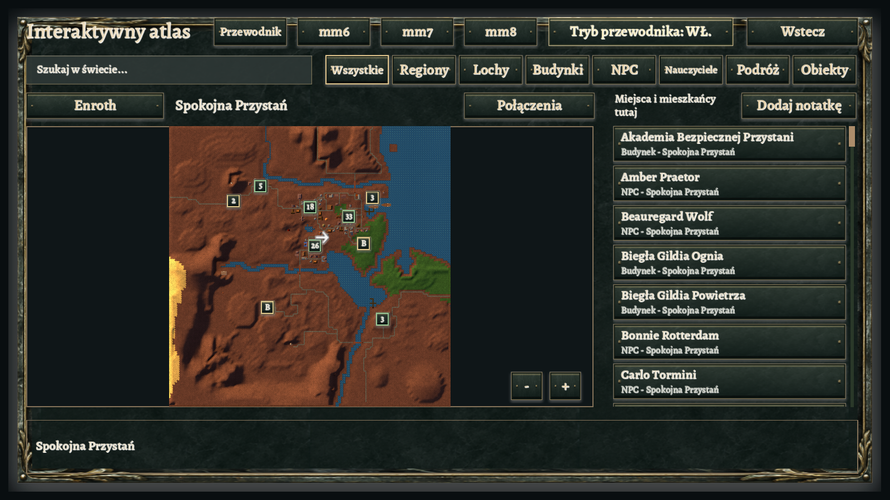
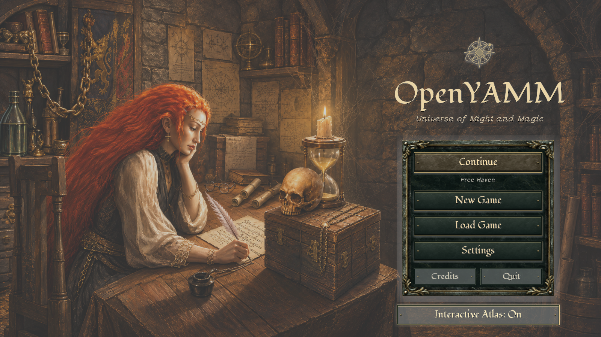
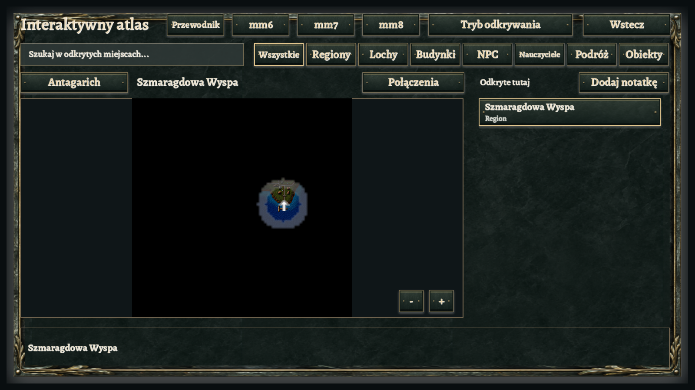

# OpenYAMM Atlas

### A native Atlas for Might & Magic VI, VII and VIII

Explore Enroth, Antagarich and Jadame with maps that remember what your party has discovered.

A community project by Karol, built on [OpenYAMM by pjasicek](https://github.com/pjasicek/openyamm).

[Download Windows 0.3.0](https://github.com/coral18/openyamm/releases/tag/atlas-v0.3.0) · [Installation](ATLAS_RELEASE.md) · [Port and save details](ATLAS_PORT.md) · [Support on Ko-fi](https://ko-fi.com/kvonloraque)

*Free Haven, MM6. Native Windows capture from the OpenYAMM 2.6 build, 17 November 2026.*

## Current release

**OpenYAMM Atlas 0.3.0** is a Windows x64 preview based on **OpenYAMM 2.6**. It includes the MM6, MM7 and MM8 Atlases, English and Polish Atlas text, and a main-menu on/off button. The source is on this repository's `main` branch and [`atlas/port-v2.6`](https://github.com/coral18/openyamm/tree/atlas/port-v2.6).

This is an Atlas-enabled game build. Its data folder alone cannot add the interface to an official OpenYAMM executable. Android has not been built or tested for this release; earlier POCO results belong to the older branch.

## Install and play

1. Download the Windows ZIP from the [0.3.0 release](https://github.com/coral18/openyamm/releases/tag/atlas-v0.3.0) and extract it into a new folder.
2. Run **Play Atlas.cmd**. The first run downloads the matching OpenYAMM 2.6 runtime packs from official hosting. Later runs reuse the completed files.
3. Start a game in MM6, MM7 or MM8. Open the Map Book by clicking the minimap, then choose Atlas in its sidebar.

The ZIP contains the executable, Atlas overlays and a pinned content index, without the multi-gigabyte game payload. You can [reuse matching packs from an existing installation](ATLAS_RELEASE.md#reuse-existing-content). Saves and settings belong to the new Atlas folder; do not extract it over your official installation.

Use **Interactive Atlas: On / Off** in the main menu to enable or disable it. The choice survives a restart, and switching it off preserves discoveries and notes. The Atlas itself still opens from the Map Book.

## Discovery and Guide Mode

Discovery Mode uses the party's exploration and observations. Unknown terrain stays hidden, and the map shows locations as your party learns about them. Visiting a region does not reveal its whole map.

Guide Mode lets you look up locations and game information. Returning to Discovery Mode does not mark those places as visited. This helps when you come back to a campaign after a few weeks and need to remember a trainer or your next destination.

The Atlas has a party position/direction arrow, search, filters, personal notes and dungeon height layers. Reference pages link items, alchemy, spells, classes, monsters and quests to places in the world. Definitions come from the active game data and geometry.

| World | Atlas coverage |
| --- | --- |
| MM6, Enroth | 15 outdoor regions and 40 playable dungeon maps; [coverage details](ATLAS_MM6.md) |
| MM7, Antagarich | Regional maps, dungeon plans, discoveries and linked reference pages |
| MM8, Jadame | Regional maps, dungeon plans, discoveries and linked reference pages |
| MM9, Chedian | Available through the base game; no MM9 Atlas in this release |

## Compatibility and checks

The 2.6 port passed the focused Atlas/localization suite, input/controller regression tests and installed-map audits in English and Polish. Native Windows runs checked the MM6, MM7 and MM8 Discovery/Guide views and return to gameplay. The new menu button passed 34 additional cases with 4,394 assertions, plus restart, keyboard and PL/EN checks in the running game.

These are regression and representative runtime checks, not complete campaign playthroughs. Physical-controller acceptance on this base and Android testing remain outstanding. Other interface languages use the normal English fallback for untranslated Atlas text.

Test copies of 2.5 saves loaded and migrated to the 2.6 save format. The official 2.6 executable can open Atlas saves, but resaving there drops the extra Atlas save data. Keep backups; the round trip does not preserve all Atlas knowledge. Future OpenYAMM versions still need a compatibility check and may need another port.

The old Extended Mod Loader and its profile format are not the integration contract for this port. It uses OpenYAMM 2.6's content mounting; a stable public plugin ABI is not claimed.

## Development

- [Atlas integration, build flags and save format](ATLAS_PORT.md)
- [MM6 coverage and metadata](ATLAS_MM6.md)
- [English and Polish localization](ATLAS_LOCALIZATION.md)
- [Windows package and content setup](ATLAS_RELEASE.md)
- [Upstream engine documentation](README_ENGINE.md)
- [Polish MM9 retail-localization importer](devdocs/MM9_POLISH_RETAIL.md): code for generating an overlay from an owned installation. Retail voices, movies and private review data are not included in this release.

The previous implementation and Mod Loader history remain on [`extended/atlas-mm8`](https://github.com/coral18/openyamm/tree/extended/atlas-mm8). Its handover and verification numbers describe that older engine base.

## Support development

I use ChatGPT Plus and regularly hit its usage limits. Support would let me move to a plan with higher limits and spend more capacity on Atlas development, compatibility work and collaboration. I'd also like to work on other Might & Magic mods and tools, and eventually an original RPG in Unreal Engine inspired by the series.

[Support Karol on Ko-fi](https://ko-fi.com/kvonloraque) · [Funding details](SUPPORT.md)

## Credits and license

Built on [OpenYAMM by pjasicek and its contributors](https://github.com/pjasicek/openyamm).

Both interactive guides that inspired the Atlas are by [u/hulululuh](https://www.reddit.com/user/hulululuh/):

- [MM7 interactive world map / guide](https://www.reddit.com/r/MightAndMagic/comments/1ww8pq0/i_made_an_interactive_world_map_guide_for_might/)
- [MM8 clickable map of Jadame](https://www.reddit.com/r/MightAndMagic/comments/1x7x7ok/simon_found_a_map_of_jadame_i_made_it_clickable/)

Their HTML, JavaScript, authored guide text and artwork are not bundled, and their complete guide content has not been imported. The native Atlas uses OpenYAMM's tables, scripts and map geometry.

Code is distributed under [GNU GPL v3](LICENSE). Original game assets retain their respective rights; the code license does not grant rights to them. See [COPYRIGHT](COPYRIGHT) for upstream notices.
